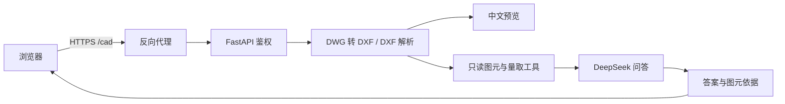

# 建筑 CAD 图纸问答 Agent

上传 DXF 或 DWG，用中文询问图纸中的文字、图块和几何信息，并点击答案依据定位原图。
这是基于 [jeremylongshore/cad-ai-agent](https://github.com/jeremylongshore/cad-ai-agent)
开发的只读问答 MVP，适合建筑背景的开发者学习 AI 应用开发、产品设计和工程验证。


## 已实现的能力

- DXF 上传；DWG 经容器内的 GNU LibreDWG 转换后解析，原文件及转换结果各限 25 MB。
- 中文交互预览和 PNG 静态预览，使用可再分发的 Noto 开源字体。
- 真实 DeepSeek 问答：检索文字和属性、统计图块、量取支持的闭合轮廓面积和周长。
- 答案携带经过后端检查的图元引用，可在预览中定位。
- 单管理员登录、服务端会话、退出与过期、登录失败限速、Origin/CSRF 校验。
- 生产静态前端、FastAPI、Docker Compose、健康检查、临时文件清理和日志轮转。
- 建筑风格登录页、图纸与问答双栏、推荐问题、使用指南、专注模式和移动端布局。

当前没有注册、体验码、多个试用账号、问答次数配额或模型费用上限。适合个人演示及受控试用，
这些能力应在向陌生用户开放前另行实现。


## 快速开始：本机 HTTPS

需要 Docker Engine / Docker Desktop、Docker Compose **2.30+** 和 Python **3.11+**。
容器构建自动安装前后端依赖并编译转换器，首次构建可能需要数分钟及网络连接。
默认使用官方镜像及包源。

在仓库根目录执行：

```bash
python3 scripts/init-config.py
docker compose -f compose.yaml -f compose.local.yaml up --build -d --wait
```

初始化程序会隐藏输入管理员密码和 DeepSeek Key，仅在 `.secrets/runtime.env` 中保存密码哈希
及模型配置，文件权限为 600。程序拒绝覆盖已有配置。DeepSeek Key 可以暂时留空，
此时可以登录、预览和解析图纸，模型问答会明确提示未配置，不会返回模拟答案。

打开 **https://localhost:8443/cad/local-qa**，使用默认账号 `admin` 和刚设置的密码登录。
如需自定义账号，初始化时使用 `python3 scripts/init-config.py --username 你的账号`。
本机 Caddy 使用自己的本地证书机构；浏览器首次访问可能提示证书未受信任。
仅对自己启动的本机实例检查并信任该证书。可以导出根证书后验证 HTTPS：

```bash
mkdir -p .local
docker compose -f compose.yaml -f compose.local.yaml cp \
  proxy:/data/caddy/pki/authorities/local/root.crt .local/caddy-root.crt
curl --cacert .local/caddy-root.crt https://localhost:8443/cad/api/health
```

本机入口仅监听回环地址。停止容器时执行：

```bash
docker compose -f compose.yaml -f compose.local.yaml down
```

命名卷中的登录状态保留；上传图纸属于临时数据，停止或重启后请重新上传。

## 体验示例

登录后点击「试用建筑示例」，或上传 `local_examples/architectural-demo.dxf` / `.dwg`。
可以问：

1. 请统计 M0921 门图块实例数量，并给出可定位依据。
2. 请量取会议室对应的 ROOM_BOUNDARY 闭合轮廓面积和周长。
3. 请列出图纸中的房间名称及对应文字图元。

预期门图块实例为 **2 个**，会议室候选轮廓面积为 **16㎡**、周长为 **16m**。
这些图纸是合成测试样本。这些数值是几何结果，不能据此认定真实建筑净面积或完整建筑语义。

## 配置与部署

`.env.example` 仅包含 Compose 的地址、端口等非敏感设置，初始化会在 `.env` 不存在时自动复制。
需要调整端口或域名时，编辑生成的 `.env`。
模型密钥和密码哈希始终放在独立的 `.secrets/runtime.env`，不要放入 `VITE_` 变量。
该运行时文件按原始值传入容器，避免 scrypt 哈希中的 `$` 被 Compose 插值。

| 配置 | 说明 |
| --- | --- |
| `CAD_PUBLIC_ORIGIN` | 浏览器访问的完整 HTTPS Origin，例如 `https://cad.example.com` |
| `CAD_HTTP_PORT` | 后端回环监听端口，默认 8323 |
| `CAD_HTTPS_PORT` | 本机 HTTPS 端口，默认 8443；改动时同步修改 Origin |
| `CAD_RUNTIME_ENV` | 受保护配置路径，默认 `./.secrets/runtime.env` |
| `DEEPSEEK_API_KEY` | 位于运行时文件，由服务端使用 |
| `DEEPSEEK_BASE_URL` | 默认 `https://api.deepseek.com` |
| `DEEPSEEK_MODEL` | 默认 `deepseek-flash`，需确保 API 账号可用 |

已有服务器反向代理时，使用根 `compose.yaml` 启动应用，将 `/cad/*` 去掉 `/cad` 前缀后
转发到 `127.0.0.1:8323`。完整说明见 [部署文档](docs/DEPLOYMENT.md)。
生产入口固定为 `web.backend.production:app`，只开放只读问答及鉴权接口；不要把保留的上游
`web.backend.main:app` 作为公网入口，也不要在公网启用 `CAD_WEB_DEV_MODE`。

## 开发与验证

使用 Python 3.12、Node.js 22。离线回归测试不需要真实 API Key，测试中模型响应使用受控替身，
生产问答始终使用配置的真实 API。

```bash
python3.12 -m venv .venv
.venv/bin/python -m pip install -r requirements-dev.txt
.venv/bin/python -m pip install --no-deps -e .
PYTHONPATH=src:. .venv/bin/python -m pytest tests/local_qa tests/deployment tests/web tests/packaging -q
cd web/frontend
npm ci
npm run test:font
npm run lint
npm run build
```

提交前从仓库根目录运行 `python3 scripts/check-release.py --tree`，暂存后运行
`python3 scripts/check-release.py`。检查器不会打印匹配到的密钥内容。
GitHub Actions 模板 `.github/ci.yml.example` 定义相同范围的测试及生产镜像构建，不配置或调用付费模型。
本次上传未启用自动测试；启用方法见 [GITHUB.md](docs/GITHUB.md)。
验证范围和可重复验收方式见 [VALIDATION.md](docs/VALIDATION.md)。
依赖兼容补丁与复核方式见 [DEPENDENCIES.md](docs/DEPENDENCIES.md)。

本机 HTTPS 启动并导出 CA 后，可用隐藏密码输入执行不调用模型的实际接口验收：

```bash
.venv/bin/python scripts/smoke-test.py \
  --base-url https://localhost:8443/cad --ca .local/caddy-root.crt
```

已有线上版本曾通过真实 DWG2000/2013/2018 上传测试、中文双预览、真实 DeepSeek 的示例问答、
点击依据定位、登录退出与会话过期检查，并通过服务重启验证。
这些验收覆盖指定样本，不构成对所有 DWG 或真实工程图纸的识别准确率保证。

## 项目结构

```text
web/frontend/       React + Vite，生产构建入口为管理员问答界面
web/backend/        FastAPI、管理员鉴权、DWG 转换、只读问答工具
src/cad_dxf_agent/  上游 CAD 解析、几何、渲染等核心模块
tests/              本项目回归与保留的上游 Web 回归测试
local_examples/     可再分发的合成 DXF / DWG 及预期结果
fonts/              开源中文字体及完整许可证
vendor/             GNU LibreDWG 固定版本源码、签名与校验信息
scripts/            安全初始化、发布检查与示例生成
docs/               部署、学习路线、来源和素材说明
```



## 能力与数据边界

- 图纸转换、解析、预览在服务器完成。问答会把相关结构化图元、文字、属性、工具结果和对话发送到 DeepSeek；当前不发送原始文件或图片。
- 默认统计 Model 空间顶层图元。嵌套块、外部参照、阵列及多布局重复表达需要额外处理。
- 单位依据 DXF 设置，需与实际标注核对；未知单位不擅自换算为米。支持的闭合几何不等于房间净面积。
- DWG 的天正代理对象、自定义对象和部分高级实体可能丢失。转换不是无损归档，应核对预览；失败时可在 CAD 软件中另存 DXF。
- 图纸和对话不是持久文档库；刷新、退出、会话过期及服务重启后可能需要重新上传。
- 本项目没有训练自有大模型，也不提供完整建筑审图或专业设计结论。

学习和作品集路线见 [LEARNING_PATH.md](docs/LEARNING_PATH.md)。
参与开发见 [CONTRIBUTING.md](CONTRIBUTING.md)，数据与安全见 [SECURITY.md](SECURITY.md)。

## 上传 GitHub

本目录已初始化为独立 Git 仓库；它的父目录及原部署目录不属于发布内容。
项目仓库：[richwin0903/architectural-cad-qa](https://github.com/richwin0903/architectural-cad-qa)。
后续提交及推送方式见 [GITHUB.md](docs/GITHUB.md)。
不要上传 `.secrets`、`.env`、私有图纸、数据库或原服务器的 SSH 配置。

## 来源与许可

应用源码继承上游 **Apache-2.0** 许可；GNU LibreDWG 转换器及相关测试样本使用 **GPL-3.0-or-later**；
Noto 字体使用 **SIL OFL 1.1**。完整来源、修改范围及各组件许可见
[NOTICE](NOTICE)、[THIRD_PARTY_NOTICES.md](THIRD_PARTY_NOTICES.md) 和 [UPSTREAM.md](docs/UPSTREAM.md)。
不同组件遵循各自许可证，不能把全部第三方文件统一标记成 Apache-2.0。
