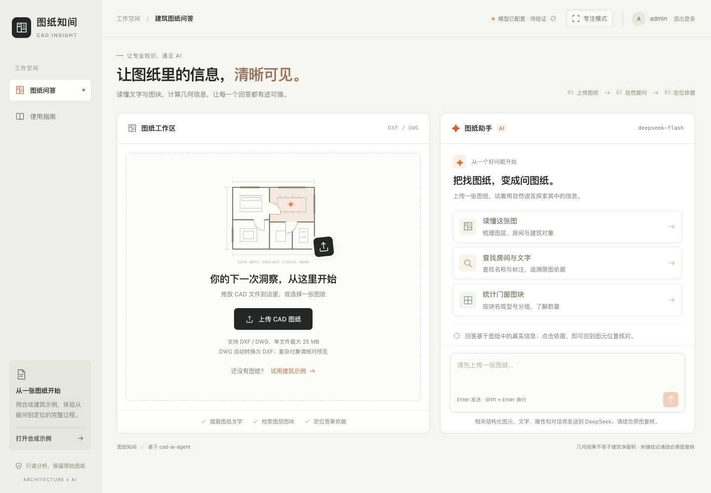
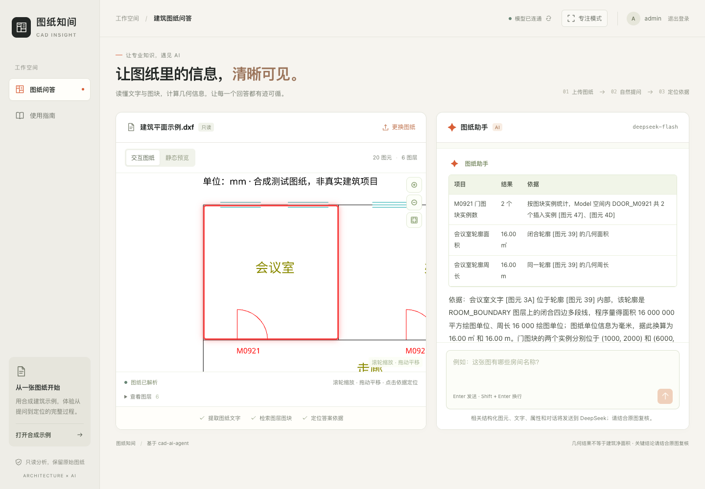
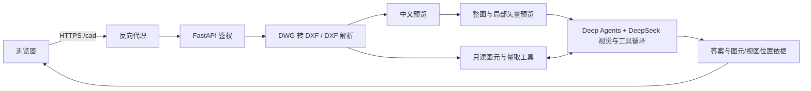

# 图纸知间 · 建筑 CAD 问答 Agent

**先看整张图，再放大局部，结合图元数据回答。**

上传 DXF 或 DWG，用中文询问“这个文件里面有什么图”、图块数量或闭合轮廓面积。
项目使用官方 **LangChain Deep Agents + DeepSeek 多模态模型**，将全图视觉、
只读检索和确定性几何计算结合起来，返回带图元或视图位置依据的答案。
这是基于 [jeremylongshore/cad-ai-agent](https://github.com/jeremylongshore/cad-ai-agent)
开发的只读问答 MVP，适合建筑背景的开发者学习 AI 应用开发、产品设计和工程验证。

[线上入口](https://wenjunjia.cloud/cad/local-qa) · [问答架构](docs/QA_ARCHITECTURE.md) · [部署文档](docs/DEPLOYMENT.md) · [验证记录](docs/VALIDATION.md)

线上实例需使用管理员账号或单独分配的试用账号登录。试用凭证不随仓库分发。



## 已实现的能力

- DXF 上传；DWG 经容器内的 GNU LibreDWG 转换后解析，原文件及转换结果各限 25 MB。
- 中文交互预览和 PNG 静态预览，使用可再分发的 Noto 开源字体。
- Deep Agents + DeepSeek 多模态问答：先看整图，再放大局部；结合文字检索、图块统计和几何量取回答。
- 答案携带经过后端检查的图元引用或实际渲染视图范围；Model 空间的依据可在交互预览中定位。
- 管理员及预分配试用账号登录、服务端会话、退出与过期、登录失败限速、Origin/CSRF 校验。
- 生产静态前端、FastAPI、Docker Compose、健康检查、临时文件清理和日志轮转。
- 建筑风格登录页、图纸与问答双栏、推荐问题、使用指南、专注模式和移动端布局。
- 默认 2 个问答并发、有界排队及真实排队状态；答案支持“有用 / 没用”反馈。
- 受保护的 30 天试用记录与管理员统计导出，登录前明确说明数据范围。

试用账号由管理员离线生成，默认首次登录后 7 天有效，每天 10 次问答、累计 30 次，每天 10 次上传。
每个账号只保留一个有效登录和最近成功上传的图纸；账号数据及额度隔离并持久化。
没有公开注册、支付或按金额计费的费用熔断。适合个人演示及逐人发放账号的受控试用。
生成、停用和调整额度见 [试用账号管理](docs/TRIAL_ACCOUNTS.md)。



以上截图展示既有界面和合成示例，不是本次私有多视图 DWG 的验收截图。

## 问答如何工作

旧问答只依靠结构化图元检索，容易根据局部内容回答“这个 CAD 里有什么图”。
当前链路在第一次模型调用前提供布局清单和实际整图预览，再由 Agent 按需检查局部。
复杂图纸的概览问题还会预先提供重叠分区，同一上传会话可复用已生成的图片：

1. **上传与解析**：DXF 直接解析，DWG 先经 LibreDWG 转换；保留图层、图块、文字和几何信息。
2. **全图概览**：枚举所有布局，优先提供 Model 和其他非空布局的整图预览，避免只看查询结果第一页。
3. **局部核对**：模型按需放大左、右、上、下的主要区域。局部图从矢量重新渲染，便于核对细节。
4. **调用工具**：用视觉判断平面、立面等图种；图块数量由程序统计，面积和周长由源 DXF 几何量取。
5. **引用与复核**：后端校验当前请求中实际查过的图元、实际渲染过的视图，再交给前端展示依据。

例如，多视图文件可以问：“这个 CAD 文件里面有什么图？请按所在位置分别说明。”
答案应覆盖可见的各组图；无法辨认的楼层、朝向或图名需要明确说明，不能从位置推断。

Deep Agents 负责计划和工具调用，DeepSeek 负责视觉与语言理解，ezdxf 负责 CAD 解析与几何核验。
本项目没有训练自有大模型，也没有让 Agent 直接操作终端或修改 CAD 文件。

## 快速开始：本机 HTTPS

需要 Docker Engine / Docker Desktop、Docker Compose **2.30+** 和 Python **3.11+**。
容器构建自动安装前后端依赖并编译转换器，首次构建可能需要数分钟及网络连接。
默认使用官方镜像及包源。

在仓库根目录执行：

```bash
python3 scripts/init-config.py
docker compose -f compose.yaml -f compose.local.yaml up --build -d --wait
```

初始化程序会隐藏输入管理员密码和 DeepSeek Key，仅在 `.secrets/runtime.env` 中保存密码哈希
及模型配置，文件权限为 600。程序拒绝覆盖已有配置。DeepSeek Key 可以暂时留空，
此时可以登录、预览和解析图纸，模型问答会明确提示未配置，不会返回模拟答案。

打开 **https://localhost:8443/cad/local-qa**，使用默认账号 `admin` 和刚设置的密码登录。
如需自定义账号，初始化时使用 `python3 scripts/init-config.py --username 你的账号`。
本机 Caddy 使用自己的本地证书机构；浏览器首次访问可能提示证书未受信任。
仅对自己启动的本机实例检查并信任该证书。可以导出根证书后验证 HTTPS：

```bash
mkdir -p .local
docker compose -f compose.yaml -f compose.local.yaml cp \
  proxy:/data/caddy/pki/authorities/local/root.crt .local/caddy-root.crt
curl --cacert .local/caddy-root.crt https://localhost:8443/cad/api/health
```

本机入口仅监听回环地址。停止容器时执行：

```bash
docker compose -f compose.yaml -f compose.local.yaml down
```

命名卷中的登录状态保留；上传图纸属于临时数据，停止或重启后请重新上传。

## 体验示例

登录后点击「试用建筑示例」，或上传 `local_examples/architectural-demo.dxf` / `.dwg`。
可以问：

1. 这张图里有什么内容？请先查看整图，再核对局部。
2. 请统计 M0921 门图块实例数量，并给出可定位依据。
3. 请量取会议室对应的 ROOM_BOUNDARY 闭合轮廓面积和周长。
4. 请列出图纸中的房间名称及对应文字图元。

预期门图块实例为 **2 个**，会议室候选轮廓面积为 **16㎡**、周长为 **16m**。
这些图纸是合成测试样本。这些数值是几何结果，不能据此认定真实建筑净面积或完整建筑语义。

## 配置与部署

`.env.example` 仅包含 Compose 的地址、端口等非敏感设置，初始化会在 `.env` 不存在时自动复制。
需要调整端口或域名时，编辑生成的 `.env`。
模型密钥和密码哈希始终放在独立的 `.secrets/runtime.env`，不要放入 `VITE_` 变量。
该运行时文件按原始值传入容器，避免 scrypt 哈希中的 `$` 被 Compose 插值。

| 配置 | 说明 |
| --- | --- |
| `CAD_PUBLIC_ORIGIN` | 浏览器访问的完整 HTTPS Origin，例如 `https://cad.example.com` |
| `CAD_HTTP_PORT` | 后端回环监听端口，默认 8323 |
| `CAD_HTTPS_PORT` | 本机 HTTPS 端口，默认 8443；改动时同步修改 Origin |
| `CAD_RUNTIME_ENV` | 受保护配置路径，默认 `./.secrets/runtime.env` |
| `DEEPSEEK_API_KEY` | 位于运行时文件，由服务端使用 |
| `DEEPSEEK_BASE_URL` | 默认 `https://api.deepseek.com` |
| `DEEPSEEK_MODEL` | 默认 `deepseek-flash`；模型须支持图像输入及工具调用，且 API 账号可用 |

已有服务器反向代理时，使用根 `compose.yaml` 启动应用，将 `/cad/*` 去掉 `/cad` 前缀后
转发到 `127.0.0.1:8323`。完整说明见 [部署文档](docs/DEPLOYMENT.md)。
生产入口固定为 `web.backend.production:app`，只开放只读问答及鉴权接口；不要把保留的上游
`web.backend.main:app` 作为公网入口，也不要在公网启用 `CAD_WEB_DEV_MODE`。

当前问答会发送整图预览和局部截图。Compose 中的 `CAD_VISION_ENABLED=false` 仅关闭保留的
上游 Gemini 管线，**不关闭本项目的 DeepSeek 图像输入**。数据发送范围见下方说明。

## 当前验证结果（2026-10-24）

| 检查 | 已确认的结果 |
| --- | --- |
| 私有多视图 DWG，真实 DeepSeek 问答 | 识别左侧 2 张平面图、右侧 4 张立面图，并放大主要区域核对 |
| 合成建筑示例，真实统计与量取 | M0921 门图块实例 2 个；会议室候选轮廓 16㎡、16m |
| 后端离线回归 | 完整回归 576 项通过，含缓存、试用隔离、排队扣额、反馈归属及记录清理检查 |
| 前端 | 开源中文字体回归、lint、生产构建通过 |
| 线上接口与运行 | HTTPS 访问、未登录拦截、登录退出、旧 Cookie 撤销及服务重启后访问通过 |

同一私有 DWG 的线上实测（不含上传时间）：

| 场景 | 优化前 | 优化后 |
| --- | --- | --- |
| 首问“这个 CAD 文件里面有什么图” | 约 103 秒 | **约 41 秒** |
| 同一会话追问右侧立面的位置与数量 | 未单独计时 | **约 3 秒** |

首问耗时减少约 60%；此次上传转换与预览另耗时约 28 秒。首问仍需准备图纸；
追问可复用图片，仍由真实模型重新回答。以上为同一样本的单次线上观测，不是性能承诺；
更换图纸、缓存未命中或复杂问题需要额外处理。
转换时有 3 个缺失定义的图块引用，预览跳过并提示；上述识别结果只覆盖实际可见内容。
真实图纸、转换文件、截图和完整问答记录不随仓库分发。

既有版本已验证过浏览器中的依据定位；本次 Deep Agents 更新验证了接口、视图坐标和前端对接，
因验收环境限制未重新完成浏览器点击定位检查。完整范围与历史记录见 [VALIDATION.md](docs/VALIDATION.md)。
单个样本通过不代表任意施工图的识别准确率或 DWG 转换无损。

## 开发与验证

使用 Python 3.12、Node.js 22。离线回归测试不需要真实 API Key，测试中模型响应使用受控替身，
生产问答始终使用配置的真实 API。

```bash
python3.12 -m venv .venv
.venv/bin/python -m pip install -r requirements-dev.txt
.venv/bin/python -m pip install --no-deps -e .
PYTHONPATH=src:. .venv/bin/python -m pytest tests/local_qa tests/deployment tests/web tests/packaging -q
cd web/frontend
npm ci
npm run test:font
npm run lint
npm run build
```

提交前从仓库根目录运行 `python3 scripts/check-release.py --tree`，暂存后运行
`python3 scripts/check-release.py`。检查器不会打印匹配到的密钥内容。
GitHub Actions 模板 `.github/ci.yml.example` 定义相同范围的测试及生产镜像构建，不配置或调用付费模型。
仓库保留 CI 模板，当前未启用 GitHub Actions；启用方法见 [GITHUB.md](docs/GITHUB.md)。
验证范围和可重复验收方式见 [VALIDATION.md](docs/VALIDATION.md)。
依赖兼容补丁与复核方式见 [DEPENDENCIES.md](docs/DEPENDENCIES.md)。

本机 HTTPS 启动并导出 CA 后，可用隐藏密码输入执行不调用模型的实际接口验收：

```bash
.venv/bin/python scripts/smoke-test.py \
  --base-url https://localhost:8443/cad --ca .local/caddy-root.crt
```

## 项目结构

```text
web/frontend/       React + Vite，生产构建入口为管理员问答界面
web/backend/        FastAPI、管理员鉴权、DWG 转换、只读问答
  cad_deep_agent.py  Deep Agents 编排、工具白名单、调用预算与模型适配
  cad_visual.py      布局清单、整图/局部渲染、视图坐标依据
  deepseek_qa.py     兼容入口、图元检索、统计、量取和引用校验
src/cad_dxf_agent/  上游 CAD 解析、几何、渲染等核心模块
tests/              本项目回归与保留的上游 Web 回归测试
local_examples/     可再分发的合成 DXF / DWG 及预期结果
fonts/              开源中文字体及完整许可证
vendor/             GNU LibreDWG 固定版本源码、签名与校验信息
scripts/            安全初始化、发布检查与示例生成
docs/               部署、学习路线、来源和素材说明
```



## 能力与数据边界

- 图纸转换、解析、预览在服务器完成。问答会把整图预览、局部截图、相关结构化图元、文字、属性、工具结果和对话发送到 DeepSeek；不发送原始 CAD 文件。
- 图种概览先看完整布局，放大后核对主要区域；视觉推断不等于确认图名、楼层、朝向或房间语义。详见 [问答架构](docs/QA_ARCHITECTURE.md)。
- 开场最多预览 4 个非空布局，每轮最多生成 10 张视图；未覆盖的布局会提示。单次问答最多 6 次模型调用、24 次工具调用，总超时 180 秒。复杂图纸可能需要拆分问题。
- 视觉依据的交互定位目前只支持 Model，纸空间依据不会提供错误的 Model 定位按钮。
- 默认统计 Model 空间顶层图元。嵌套块、外部参照、阵列及多布局重复表达需要额外处理。
- 单位依据 DXF 设置，需与实际标注核对；未知单位不擅自换算为米。支持的闭合几何不等于房间净面积。
- DWG 的天正代理对象、自定义对象和部分高级实体可能丢失。转换不是无损归档，应核对预览；失败时可在 CAD 软件中另存 DXF。
- 缺失图块引用会在渲染副本中跳过并提示；不修改源文件。外部栅格图片仅显示代理边框，不加载其引用文件。
- Agent 每次请求独立运行，图纸图片在当前上传会话内有限缓存，答案不缓存；只开放只读 CAD 与计划工具；不开放通用文件、终端和委派工具，不启用 LangSmith 追踪或跨用户持久记忆。
- 图纸和对话不是持久文档库；刷新、退出、会话过期及服务重启后可能需要重新上传。
- 本项目没有训练自有大模型，也不提供完整建筑审图或专业设计结论。

学习和作品集路线见 [LEARNING_PATH.md](docs/LEARNING_PATH.md)。
参与开发见 [CONTRIBUTING.md](CONTRIBUTING.md)，数据与安全见 [SECURITY.md](SECURITY.md)。

## 仓库与贡献

项目仓库：[richwin0903/architectural-cad-qa](https://github.com/richwin0903/architectural-cad-qa)。
后续提交及推送方式见 [GITHUB.md](docs/GITHUB.md)。
不要上传 `.secrets`、`.env`、私有图纸、数据库或原服务器的 SSH 配置。

本项目开发中使用了 [Claude](https://www.anthropic.com/claude)（Anthropic）作为 AI 编程助手，
在提交中以共同作者署名。

## 来源与许可

应用源码继承上游 **Apache-2.0** 许可；GNU LibreDWG 转换器及相关测试样本使用 **GPL-3.0-or-later**；
Noto 字体使用 **SIL OFL 1.1**。完整来源、修改范围及各组件许可见
[NOTICE](NOTICE)、[THIRD_PARTY_NOTICES.md](THIRD_PARTY_NOTICES.md) 和 [UPSTREAM.md](docs/UPSTREAM.md)。
Deep Agents 与 langchain-deepseek 使用 MIT 许可。不同组件遵循各自许可证，
不能把全部第三方文件统一标记成 Apache-2.0。
